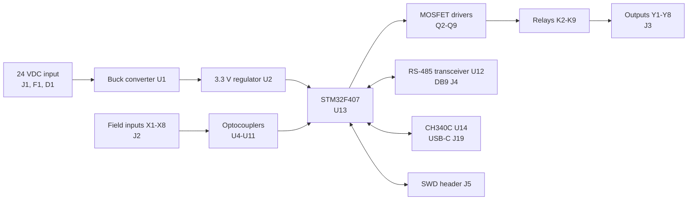

# STM32 Mini PLC v1.0

A compact industrial-style PLC board designed in KiCad, built around an **STM32F407** microcontroller. It provides **8 optically isolated digital inputs**, **8 relay outputs**, **RS-485** communication and **USB-C** serial/bootloader access, all powered from **24 VDC**.

  

> **Status:** Hardware design v1.0 complete. The board has not been manufactured or tested, and no firmware has been written yet.

---

## Table of contents

- [Key features](#key-features)
- [Board gallery](#board-gallery)
- [Specifications](#specifications)
- [System overview](#system-overview)
- [Sub-systems](#sub-systems)
- [Connectors](#connectors)
- [PCB design](#pcb-design)
- [Repository structure](#repository-structure)
- [Project status and roadmap](#project-status-and-roadmap)
- [Tools](#tools)
- [License and credits](#license-and-credits)

---

## Key features

- STM32F407 microcontroller as the processing core
- 8 optically isolated digital inputs (optocoupler per channel)
- 8 relay outputs, MOSFET-driven, with freewheeling diodes
- RS-485 interface on a DB9 connector (suitable for Modbus RTU)
- USB-C with CH340C USB-to-UART bridge for serial debugging and bootloader flashing
- 5-pin SWD header for ST-LINK programming and debugging
- 24 VDC industrial supply with fuse and reverse-polarity protection
- Status LEDs on inputs and outputs
- Reset button

---

## Board gallery

### 3D render: top angle

### 3D render: side view

### 3D render: back side
Back side showing input labels (X1 to X8), copper routing and relay output pads.

### PCB layout (KiCad PCB editor)
Red traces are the top copper layer and blue traces are the bottom copper layer. The logic section (power, STM32, inputs, communication) is at the top, and the relay and output section is at the bottom.

---

## Specifications

| Parameter | Value |
|---|---|
| Microcontroller | STM32F407 |
| Supply input | 24 VDC |
| Digital inputs | 8, optically isolated |
| Relay outputs | 8, rated 250 VAC / 30 VDC, 5 A (per board silkscreen) |
| Communication | RS-485 (DB9 connector), USB-C (UART bridge) |
| Programming / debug | 5-pin SWD header for ST-LINK |
| Design tool | KiCad |
| Board layers | 2 (top and bottom copper) |
| Version | v1.0 |

---

## System overview

---

## Sub-systems

| Sub-system | Key components | Description |
|---|---|---|
| Power stage | J1, F1, D1, U1, U2 | Accepts 24 VDC industrial input, protected by a fuse and a reverse-polarity diode. A switching buck converter (U1) and a 3.3 V linear regulator (U2) power the logic. |
| Processing core | U13 (STM32F407), C9 to C11 | Main microcontroller for application logic, with decoupling capacitors for stability. |
| Programming and debug | J5 (3V3, SWDIO, RST, SWCLK, GND) | 5-pin header for debugging and flashing with an external ST-LINK. Pin 1 is the 3.3 V reference (VTREF). |
| USB and serial | J19 (USB-C), U14 (CH340C) | USB-to-UART bridge for serial monitoring (printf debugging) and bootloader flashing. |
| Isolated digital inputs | J2, U4 to U11 (optocouplers) | 8 optically isolated channels that protect the STM32 from field-side voltage transients. |
| Relay output stage | K2 to K9, Q2 to Q9 (MOSFETs), D13 to D20, J3 | 8 electromechanical relays driven by MOSFET switches, with freewheeling diodes for inductive kickback protection. |
| Industrial communication | U12 (RS-485 transceiver), J4 | Differential serial interface for fieldbus networks. The hardware is suitable for Modbus RTU. |

---

## Connectors

| Ref | Function | Pins |
|---|---|---|
| J1 | 24 VDC power input | 24 V, 0 V |
| J2 | Digital inputs | X1 to X8, GND (see silkscreen) |
| J3 | Relay outputs | Y1 to Y8, plus common terminals (see silkscreen) |
| J4 | RS-485 (DB9) | Differential A/B, GND |
| J5 | SWD programming | 3V3, SWDIO, SWCLK, RST, GND |
| J19 | USB-C | UART bridge and bootloader |

---

## PCB design

- Logic section (power, MCU, optocoupled inputs, communication) kept separate from the relay section
- Relays placed along the bottom edge with output terminals on the same side
- Input terminal block along the top edge
- Mounting holes in all four corners
- Silkscreen labels for all terminals and ratings (Input: 24 V DC, Relay outputs: 250 VAC / 30 VDC, 5 A)

---

## Project status and roadmap

- [x] Schematic design
- [x] PCB layout
- [x] 3D model review
- [ ] Design rule check and final review
- [ ] Manufacture the board
- [ ] Write firmware
- [ ] Hardware testing

Specifications above come from the design, not from measurements on a built board.

---

## Tools

- KiCad (schematic, PCB layout, 3D viewer)

-

Designed by: *Noraiz*
